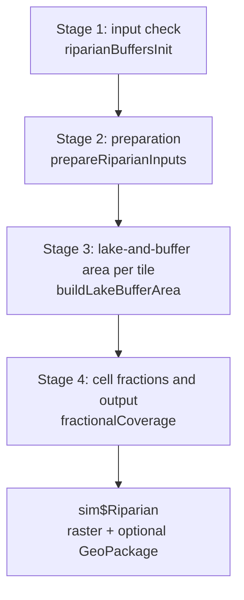
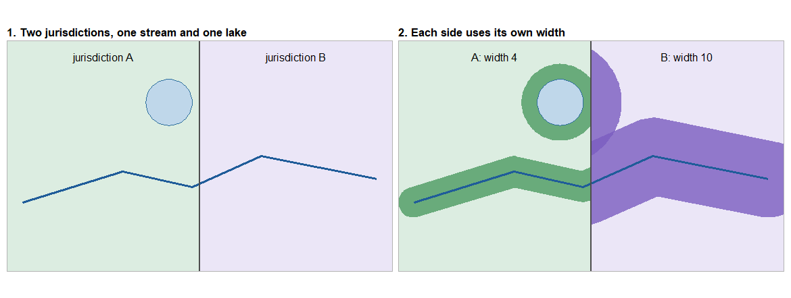
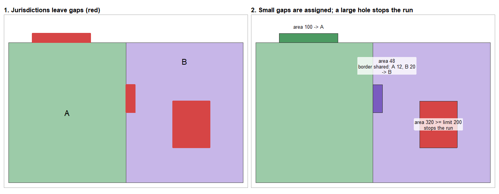
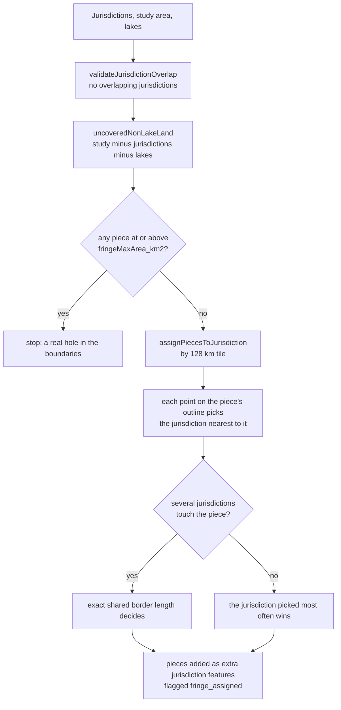
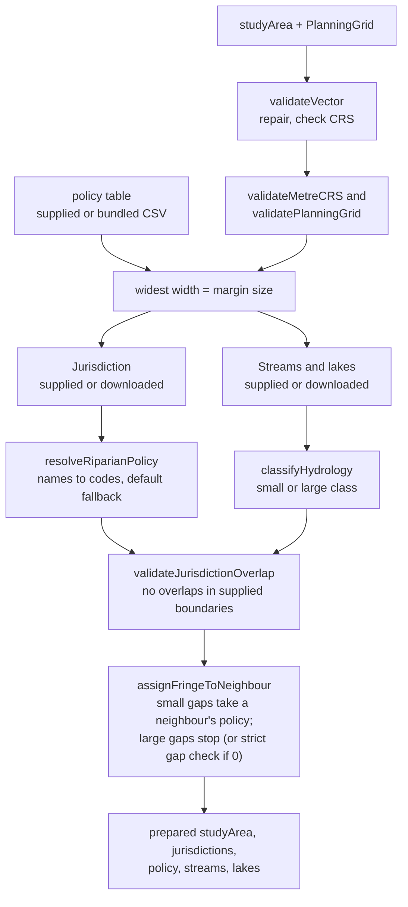
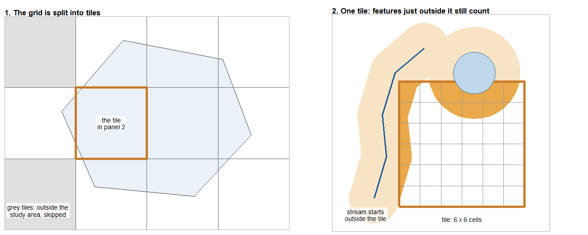
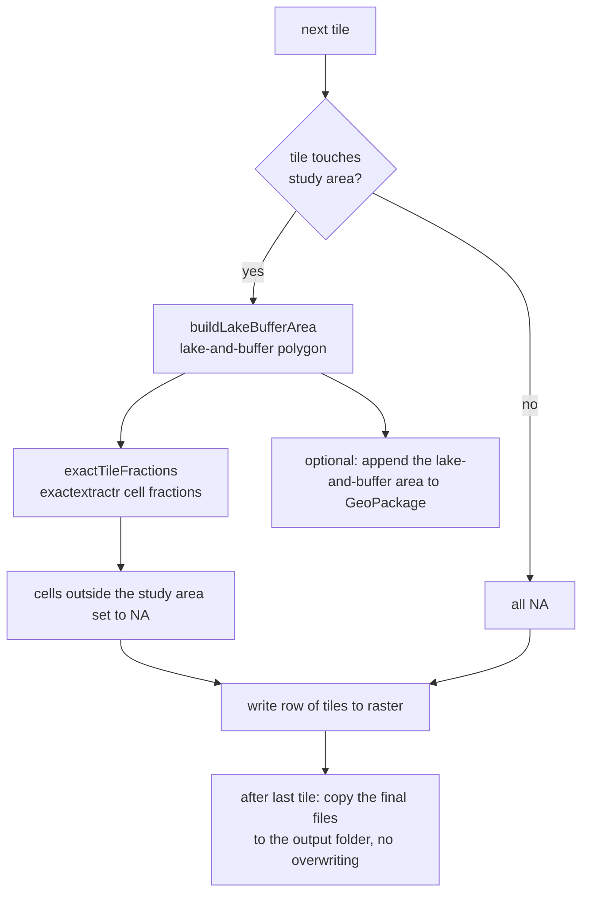
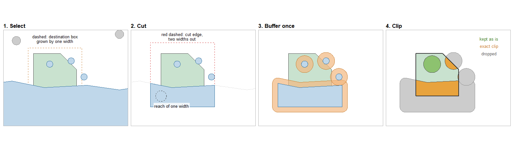
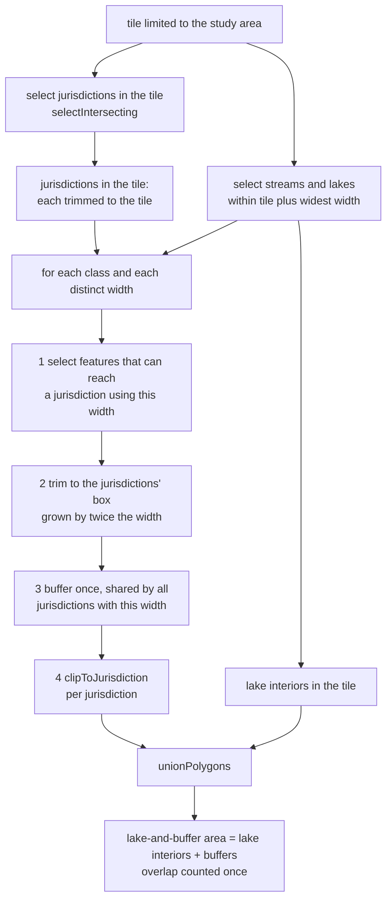

# RiparianBuffers

`RiparianBuffers` is a SpaDES module that answers one question for every
cell of a map grid: **what fraction of this cell is lake water or lies within a
protective buffer of a lake or stream?** The answer is a single-layer raster,
`sim$Riparian$riparianFraction`, with the same cells as the input
target reference raster (`PlanningGrid`). The module only reads its inputs and never changes them.

## Contents

1. [Simple terms](#simple-terms)
2. [What the numbers mean](#what-the-numbers-mean)
3. [Inputs](#inputs)
4. [How it works](#how-it-works)
5. [Outputs](#outputs)
6. [Using it in a simulation](#using-it-in-a-simulation)
7. [Validation and resource limits](#validation-and-resource-limits)

## Simple terms

| Word | Meaning here |
|---|---|
| Study area | The region you want results for (a polygon). |
| Target reference raster | The grid of square cells the result is reported on. |
| Jurisdiction | A province or state. Each one has its own buffer widths. |
| Buffer | A band drawn around a stream or lake, a set distance wide. |
| Lake-and-buffer area | All the water and buffer area together, with overlaps counted once. |
| Fraction | The part of one grid cell covered by the lake-and-buffer area, from 0 to 1. |
| Margin | A strip around the study area, as wide as the widest buffer, so features just outside it still count. |
| Tile | A block of grid cells (128 x 128 by default) processed one at a time. |
| Fringe | A tiny piece of land that no jurisdiction polygon covers, usually along a coast. |

## What the numbers mean

> The output measures combined lake-and-riparian-buffer coverage, not
> riparian land alone. Mapped lake water surfaces are included along with
> policy-width buffers on surrounding land. A grid cell entirely inside a
> mapped lake and the study area has `riparianFraction = 1`. Lake water
> overlapped by stream or lake buffers is counted once, not added repeatedly.
> The denominator is the full grid-cell area, including water. Cells
> entirely outside the study area are `NA`. These values are a hydrological
> influence/coverage signal, not a classification of harvestable land.

For example, 10 ha of buffered land plus 5 ha of mapped lake water in a 100 ha
cell gives 15 / 100 = 0.15, after merging any overlap. Streams are lines in the
source data, so they have no water surface of their own: only lake polygons and
the buffers contribute.

Cells on the edge of the study area are still divided by their **full** area, so
a cell that is only partly inside the study area gets a lower value. A cell that
is completely outside gets `NA`:

Fractions are exact area overlaps between polygons and cells, in the grid's
projected coordinate system (within a numerical tolerance of 1e-6). They are not
corrected for map-projection distortion, and they do not show that the source
streams and lakes or the policy is complete.

## Inputs

### Data inputs

Everything the module reads from the `simList`. Only `studyArea` and
`PlanningGrid` (the target reference raster) must be supplied.

| Input | Required | Type | What it is | If missing |
|---|---|---|---|---|
| `studyArea` | **Yes** | `SpatVector` or `sf` polygons, projected CRS in metres | The region to compute. | Stops with an error. |
| `PlanningGrid` | Practically yes | single-layer `SpatRaster`, same CRS as `studyArea`, extent covering it | The target reference raster: the grid of cells the result is reported on. A supplied raster is used as is and never modified. | A 240 m grid over `studyArea` is built, only if no other module promises one. |
| `Jurisdiction` | No | `SpatVector` or `sf` polygons | Provinces or states. Must carry a name or code column (`jurisdiction_code`, `jurisdiction`, `NAME_En`, `name`, `postal`, ...). Must not overlap, and must cover all non-lake land of the study area, apart from small fringes (see below). | North American political divisions 2021 v3 is downloaded. |
| `riparianBufferPolicy` | No | `data.frame` | Buffer widths in metres per jurisdiction (columns below). Needs one `default` row. | The bundled `data/riparianBufferPolicy.csv` is used. |
| `Hydrology_streams` | No | `SpatVector` or `sf` lines | Stream lines with `ORD_STRA` (Strahler order) or a `hydro_class` column. | HydroRIVERS North America is downloaded. |
| `Hydrology_lakes` | No | `SpatVector` or `sf` polygons | Lake polygons with `Lake_area` (km2) or a `hydro_class` column. | Global HydroLAKES is downloaded. |

A valid, empty vector counts as "supplied": it means "none of this", and does
not trigger a download. If another module promises one of these inputs but has
not produced it by `init`, the module stops instead of downloading a competing
copy.

### Policy table (`riparianBufferPolicy`)

One row per jurisdiction, all widths in metres. Column names are fixed.

| Column | Meaning |
|---|---|
| `jurisdiction` | Code such as `ON`, or `default`. Province names are translated to codes. |
| `small_stream` | Width around streams of Strahler order below 4. |
| `large_stream` | Width around streams of Strahler order 4 or more. |
| `small_lake` | Width around lakes with `Lake_area` below 1 km2. |
| `large_lake` | Width around lakes with `Lake_area` of 1 km2 or more. |

The bundled table holds simplified analytical assumptions, **not legal
US/Canadian policy**:

| `jurisdiction` | `small_stream` | `large_stream` | `small_lake` | `large_lake` |
|---|---|---|---|---|
| `default` | 30 | 50 | 30 | 50 |
| `ON` | 30 | 50 | 30 | 50 |
| `QC` | 20 | 40 | 20 | 40 |
| `NB` | 30 | 50 | 30 | 50 |
| `NS` | 30 | 50 | 30 | 50 |
| `PE` | 30 | 50 | 30 | 50 |
| `NL` | 30 | 50 | 30 | 50 |

A jurisdiction with no row uses the `default` row. Each such case is reported in
`policyFallback`. A width of 0 means no buffer for that class.

### Parameters

| Parameter | Default | Meaning |
|---|---|---|
| `tileCells` | `128` | Cells per tile side. Larger tiles need more memory. |
| `fringeMaxArea_km2` | `50` | Uncovered land pieces smaller than this take a neighbouring jurisdiction's policy; a larger one stops the run. `0` turns the step off and keeps a strict check. |
| `exportVectorBuffer` | `FALSE` | `TRUE` also writes the lake-and-buffer area as a GeoPackage (`riparian_buffers.gpkg`); the raster is unchanged. Turns `resume` off, because the tile areas are not saved. |
| `jurisdictionMargin_m` | `100000` | Jurisdictions are cropped to the study extent plus this margin (metres) before repair. Too small a margin makes the jurisdiction check report uncovered land. |
| `workers` | `4` | Number of R processes used for the fringe assignment and processing the tiles. `1` runs everything in the main process. The raster is identical for any value. Each worker holds its own copy of the prepared inputs, so memory grows with the number of workers. |
| `resume` | `TRUE` | Save each finished tile in the scratch folder so a rerun after a failure skips it. Ignored, with a message, when `exportVectorBuffer` is `TRUE`. |

### Folders and packages

| Item | Where |
|---|---|
| Downloaded and cached sources | `inputPath/RiparianBuffers/` |
| Result files | `outputPath/RiparianBuffers/` |
| Temporary files | `scratchPath/RiparianBuffers/` (inside the output folder if no scratch path is set) |
| Packages | `SpaDES.core`, `terra`, `sf`, `exactextractr` |

Downloads are large, need internet access and disk space, and are cached for
reuse. A failed download or validation stops with the source's name, its URL and
the local folder.

### How streams and lakes are classified

| Feature | Rule | Class |
|---|---|---|
| Stream | `ORD_STRA` below 4 | `small_stream` |
| Stream | `ORD_STRA` 4 or more | `large_stream` |
| Lake | whole-lake `Lake_area` below 1 km2 | `small_lake` |
| Lake | whole-lake `Lake_area` 1 km2 or more | `large_lake` |

Attributes are checked, not invented: a missing, negative or conflicting value
stops the run.

## How it works

The module runs once, in the SpaDES `init` event. The work is done by the
functions in `R/`. This section explains the idea first, with drawings, then
shows how the functions are organised.

### The idea in four steps

| Stage | Main function | In plain words |
|---|---|---|
| 1. Input check | `riparianBuffersInit` | Check that the study area, grid and parameters make sense. |
| 2. Preparation | `prepareRiparianInputs` | Load, repair and classify the data, and make sure every piece of land has a jurisdiction. |
| 3. Lake-and-buffer area | `buildLakeBufferArea` | For one tile, draw the buffers and merge them with the lakes. |
| 4. Fractions and output | `fractionalCoverage` | Measure how much of each cell the lake-and-buffer area covers, and write the files. |

### Step A: take only the data that can matter (the margin)

Reading a continent's worth of streams and lakes would be slow and wasteful.
The module draws a box around the study area, makes it bigger by the widest
buffer width, and keeps only features that touch that larger box (the margin).
Features are kept **whole**: a stream that crosses the edge of the margin is not trimmed
there, so no artificial endpoints are created.

Functions: `readRiparianMargin`, `selectRiparianMargin`.

### Step B: the buffer width depends on where the buffer lands

Each jurisdiction has its own widths. A stream that crosses a border does not
get one width for its whole length: the part that lands in jurisdiction A is
buffered with A's width, and the part that lands in B with B's width. So the
width is chosen by the jurisdiction **the buffer lands in**, not by the one the
stream itself lies in.

Functions: `resolveRiparianPolicy`, `classifyHydrology`.

### Step C: small gaps between jurisdictions (fringes)

Jurisdiction outlines rarely match coastlines exactly, so thin slivers of land
are left with no jurisdiction. Without a rule the run would stop on the first
one. Instead, every uncovered piece smaller than `fringeMaxArea_km2` takes the
policy of its neighbour, chosen like this:

1. If it touches one jurisdiction, that one is used.
2. If it touches several, the one sharing the **longest border** wins.
3. If it touches none, the nearest one is used.

A piece at or above the limit is treated as a real hole in the boundaries and
stops the run, so a missing province is never hidden.

(Areas and border lengths in the drawing are in arbitrary units, with a limit of
200.)

Why the search is tiled: comparing every piece with the whole jurisdiction layer
(millions of vertices) ran out of memory on a large study area, so each group of
pieces is compared with a small crop of the layer. Overlaps are checked on the
original jurisdictions first so the module does not have to re-dissolve the
newly attached fringe pieces afterwards. The count, total area and largest piece
are reported in a message and in `Riparian$fringeAssigned`.

Functions: `validateJurisdictionOverlap`, `assignFringeToNeighbour`,
`assignPiecesToJurisdiction`, `uncoveredNonLakeLand`, `nonLakeLandArea`,
`validateJurisdictionGap`, `validateJurisdictionCoverage`.

### Preparation, end to end

Missing sources are obtained by `obtainRiparianSource`. `riparianSource` names
the three datasets, and `validateShapefile` and `zipShapefileProblem` check
cached and downloaded files before they are trusted.

### Step D: work one tile at a time

The grid can have millions of cells, so it is split into tiles of `tileCells` x
`tileCells` cells. Tiles do not depend on each other, so `workers` separate R
processes compute them at the same time, while the main process writes the
raster one row of tiles at a time, in order. Tiles outside the study area are
skipped. A tile still uses features that start just outside it, because a nearby
stream's buffer reaches into the tile.

If a tile fails, the error names the tile, its row and column and its extent, so
it can be rerun alone. With `resume = TRUE` each finished tile is also saved in
`<scratch>/RiparianBuffers/riparian_progress`. Running again with the same
inputs and code skips those tiles; if anything that affects the result has
changed, the saved tiles are discarded and the run starts over. The folder is
deleted once the final files are written.

Functions: `fractionalCoverage`, `exactTileFractions`.

### Step E: inside one tile

Step D hands each tile to one function, `buildLakeBufferArea`. Its job is to
return the **lake-and-buffer area** of the tile: a single polygon made of every
lake interior plus every riparian buffer that falls inside the tile and the
study area, with each buffer drawn at the width of the jurisdiction it lands in.
The module then measures how much of each grid cell this polygon covers (see
Step D). Producing it correctly is the heart of the module, and it is also the
slowest part, because a buffer has to be computed around every vertex of a
stream or lake outline, and the largest lakes have hundreds of thousands of
vertices.

Throughout this step, "jurisdiction" means one jurisdiction polygon trimmed to the
tile, and it is the jurisdiction the buffer **lands in** (see Step B). Because
the fringe step adds extra jurisdiction features (Step C), one province can be
several jurisdictions here. A stream that crosses a border is buffered once per
side, and each side has its own width.

Before the four steps, the function sets up the tile:

- **The tile, limited to the study area.** The tile's box, clipped to the study
  area, so nothing outside the study area is counted.
- **The jurisdictions in the tile.** The jurisdictions that touch the tile,
  each trimmed to the tile. Each one is matched to its row of the policy table.
- **Nearby streams and lakes.** All streams and lakes that touch the tile's box
  grown by the widest width in the policy. Anything farther away cannot reach
  the tile.

Then, for each class (small stream, large stream, small lake, large lake) and
each distinct width used by the jurisdictions for that class, the module does
four things:

1. **Select.** Keep only the features whose buffer could reach a jurisdiction
   that uses this width. Features that cannot reach it are never buffered (grey).
   *Why it matters:* the nearby streams and lakes include features that are near
   the tile but far from the jurisdictions that use this particular width, and
   buffering them would be wasted work. The test uses the jurisdiction's
   bounding box grown by the width, which is cheap and errs on the side of
   keeping a feature, so it never drops one that matters.
2. **Trim.** Trim those features to a box around the jurisdictions, made bigger
   by **two widths** (red dashed line), then buffer the trimmed copy. The
   original streams and lakes are never modified.
   *Why it matters:* the cost of a buffer grows with the number of vertices, so
   a huge lake would dominate the run time even if only a small part of its shore
   is near the tile. Trimming removes most of those vertices before the costly
   step. It is safe because the buffer at a point depends only on source within
   one width of that point, and the trim edge is two widths away from every
   jurisdiction, so nothing inside a jurisdiction can notice the trim (the
   second width is a safety margin). Without the margin the trim could leave an
   artificial shoreline or line end and create a false edge in the buffer.
3. **Buffer once.** Buffer the trimmed features with this width, and let all the
   jurisdictions that use this width share the result.
   *Why it matters:* a buffer depends only on the width, not on which
   jurisdiction it will be given to. Since one province can be many
   jurisdictions here, buffering for each would repeat the same expensive work
   many times. A width of zero adds nothing and is skipped.
4. **Clip.** Give each jurisdiction the part of the buffer that lies inside it.
   Buffers wholly inside the jurisdiction are kept as they are, and only the
   ones that cross its border go through the precise (slower) clip.
   *Why it matters:* this step is what applies the policy. A stream that crosses
   a border keeps A's width on A's side and B's width on B's side, because each
   jurisdiction keeps only its own buffer. Skipping the precise clip for buffers
   that are entirely inside is a speed-up with an identical result, because the
   precise clip is the most expensive operation when the jurisdiction has a very
   detailed boundary.

When all the classes and widths are done, two more things happen:

- **Add the lake interiors.** The mapped surface of every nearby lake is added
  to the lake-and-buffer area, whatever the policy says. *Why it matters:* a
  lake's surface does not depend on a jurisdiction, and a jurisdiction layer may
  not cover water at all. Without this, a cell lying wholly inside a big lake,
  possibly far from its shore, would be counted as having no riparian area.
- **Merge.** All the pieces (buffers from different features, classes and
  jurisdictions, and the lake interiors) are dissolved into one polygon with no
  overlaps. *Why it matters:* the pieces overlap, for example where two streams
  meet or where a buffer runs over a lake. If they were left separate, the same
  area would be counted more than once and a cell fraction could exceed what is
  really covered.

Functions: `buildLakeBufferArea`, `clipToJurisdiction`, `selectIntersecting`,
`intersectPolygons`, `unionPolygons`, `polygonOnly`.

### Function map

| File | Functions | Role |
|---|---|---|
| `RiparianBuffers.R` | module definition | Parameters, inputs, outputs. |
| `riparianBuffersInit.R` | `riparianBuffersInit` | Stage 1; calls stages 2 and 4; stores `Riparian`. |
| `prepareRiparianInputs.R` | `prepareRiparianInputs`, `obtainRiparianSource`, `riparianSource`, `validateShapefile`, `zipShapefileProblem`, `readRiparianMargin`, `selectRiparianMargin` | Stage 2: obtain, read and select inputs. |
| `validateRiparianInputs.R` | `validateVector`, `validateMetreCRS`, `validatePlanningGrid`, `classifyHydrology` | Stage 2: validation and classes. |
| `validateRiparianInputs.R` | `uncoveredNonLakeLand`, `assignFringeToNeighbour`, `nonLakeLandArea`, `validateJurisdictionOverlap`, `validateJurisdictionGap`, `validateJurisdictionCoverage` | Fringes and the jurisdiction check. |
| `resolveRiparianPolicy.R` | `resolveRiparianPolicy` | Maps jurisdictions to policy rows, with default fallback. |
| `buildLakeBufferArea.R` | `buildLakeBufferArea`, `clipToJurisdiction`, `selectIntersecting`, `intersectPolygons`, `unionPolygons`, `polygonOnly` | Stage 3: the lake-and-buffer area of a tile. |
| `fractionalCoverage.R` | `fractionalCoverage`, `exactTileFractions` | Stage 4: processing the tiles, cell fractions, writing the files. |

The pictures are drawn by `scripts/make_readme_figures.R` from invented shapes
(nothing there reads real data) and saved in `docs/`.

### Precision notes

- Buffer edges are polygons with 30 segments per quarter circle, not ideal
  arcs. Exact coverage applies to those polygons.
- The tolerance for comparing results is an absolute difference of **1e-6** in
  the fraction (about 1 m2 in a 1000 m cell). It is recorded as
  `coverageTolerance`.
- Areas and widths are planar, in the grid's projected CRS.

## Outputs

`sim$Riparian` is a list:

| Element | Content |
|---|---|
| `riparianFraction` | The raster described above. |
| `rasterFile` | Path to `riparian_fraction.tif`. |
| `vectorBufferFile` | Path to `riparian_buffers.gpkg`, or `NULL` when export is off. |
| `policy` | The widths actually used, including filled-in defaults. |
| `policyFallback` | Jurisdictions that had no policy row and used `default`. |
| `fringeAssigned` | Pieces, area and largest piece assigned to each jurisdiction (or `NULL`). |
| `fringeMaxArea_km2`, `tileCells`, `exportVectorBuffer` | Parameters used. |
| `method`, `coverageConvention`, `coverageTolerance`, `projectionConvention`, `borderRule`, `streamConvention`, `lakeInteriorsExcluded` | Plain-text description of what was computed (`lakeInteriorsExcluded` is `FALSE`). |
| `sourceCRS`, `geometryRepairs`, `sources`, `marginWidth_m`, `marginExtent`, `policyAssumption` | Provenance: input coordinate systems, repairs, where data came from, and the margin. |

The GeoPackage is the final lake-and-buffer area (water plus buffers), in the output CRS. It
is not raw stream and lake data and not a habitat boundary. Its `tile_id` field names the
tile each piece came from. Neighbouring pieces may visibly meet at tile edges;
those are processing seams, not ecological boundaries, and no area is
duplicated. It is a single file with one layer, `riparian_buffers`, and has no
practical size limit, so the full study area can be exported (a Shapefile would
stop at 2 GiB).

Existing output names are protected: the module will not overwrite them. Files
are built in a temporary folder and copied to the output folder only when complete.

## Using it in a simulation

Put the module in the module path and supply `studyArea` and, ideally,
`PlanningGrid` (the target reference raster). The module outputs only `Riparian`. Any stream, lake or
jurisdiction data it downloads stay inside the module, and the objects you
supplied are never altered.

See `scripts/demo_RiparianBuffers.R` for an offline synthetic run.

## Validation and resource limits

Run the offline suite by sourcing `tests/unitTests.R` and calling
`unitTests(moduleDir, scratchDir)` with an explicit scratch folder. Tests cover
synthetic analytical fractions, mocked downloads, lake interiors, cross-border
policies, tile equivalence and file exports.

On an earlier version of the module, a 200 km Ottawa/Ontario-Quebec test at
1000 m resolution with vector export took 106.71 seconds using exactextractr,
versus 846.89 seconds with the earlier sf cell-intersection engine. The maximum
fraction difference across that test was 1.09e-7, with identical outside-study
masks and no cells above 1e-6. This was a single run and has not been re-timed
on the current code.

A full run over the Eastern Canada study area (6 features, about
3.7 million km2, 8.4 million cells at 1000 m, 544 tiles, no vector export) was
timed with 1, 4 and 8 workers on the current code. The machine was an Intel
i9-9940X (14 cores, 28 logical) with about 128 GB of RAM. Each configuration
was run once, in a fresh scratch folder, one after the other.

| Workers | Preparation | Worker start-up | Processing the tiles and writing files | Module total | Whole script |
|--------:|------------:|----------------:|--------------------------:|-------------:|-------------:|
| 1 | 12.8 min | 0.1 min | 53.1 min | 66.0 min | 68.5 min |
| 4 | 10.8 min | 1.5 min | 13.0 min | 25.3 min | 32.5 min |
| 8 | 10.8 min | 1.5 min | 7.4 min | 19.7 min | 25.2 min |

"Preparation" covers repairing the jurisdictions, preparing the streams and lakes, the
overlap check and the fringe assignment (136,649 uncovered non-lake pieces,
1,817.6 km2). "Module total" is the sum of the three stages, measured from the
start of the simulation. "Whole script" also includes reading the source
shapefiles before the simulation starts, which took 2.6, 7.2 and 5.4 minutes in
these runs; that time is outside the module and varies with disk caching. Processing
the tiles sped up about 4.1 times with 4 workers and 7.2 times with 8, while the
preparation barely changed, so it becomes the largest share of the run once there
are several workers. Fringe assignment and processing the tiles use the workers; the rest
of the preparation does not. Adding vector export (4 workers) took 33.4 minutes
for the whole script in a single run, and wrote a 2.5 GB GeoPackage.

The three rasters have the same grid, the same `NA` cells and identical values
(maximum absolute difference 0), and match an earlier 4-worker run made before
the jurisdiction check was moved ahead of the fringe assignment. An older comparison
of the output before and after the buffer optimisations (about 157 and 110.5
minutes) found that 454 of 3,719,184 valid cells differ by more than 1e-9, and
two by slightly more than the 1e-6 tolerance (1.9e-6 and 1.6e-6); those two cells
have not been investigated, and the comparison was not repeated with the current
rasters. The output was not compared against an independent reference.

Timings depend on the machine. On the first attempt, the 4-worker and the
8-worker runs each stopped with a geometry error (GEOS "Points of LinearRing do
not form a closed linestring" in a worker, and "ParseException: Invalid HEX char"
in the main process). Repeating them unchanged completed with the identical
raster, and the cause was not isolated. Earlier attempts to repeat a full run also
ended in R session crashes while another process held most of the machine's
memory. Treat a failed full run as possibly transient; rerunning with the default
`resume = TRUE` and the same scratch folder continues from the tiles already saved.

Start with a representative subset when trying new data.

`tileCells` defaults to 128 cells per tile side. Larger tiles can need more
memory and more complex geometry operations. Before any repair, jurisdictions
are cropped to the study extent plus `jurisdictionMargin_m` (100 km; a module parameter), because the continental layer has millions of
vertices and only the part near the study area is used. On the ON/QC 200 km test
this took preparation from 278 s to 4.8 s with an identical raster. A margin that
is too small would leave an artificial edge that looks like uncovered land, and
the run would then stop with an uncovered-land error. `workers` (default 4) speeds up the
fringe assignment and processing the tiles, but not the other preparation steps
(repairing and validating the jurisdictions, and finding the uncovered land),
which run in the main process. Every worker keeps its own copy of the prepared
inputs, so check memory before raising it on a large area. With
`exportVectorBuffer = TRUE` (not the default) the lake-and-buffer areas are written by the main process, in
tile order, and the run cannot be resumed.
Per-tile cost is dominated by buffering and clipping near very large lakes and by
jurisdictions with very detailed boundaries.
