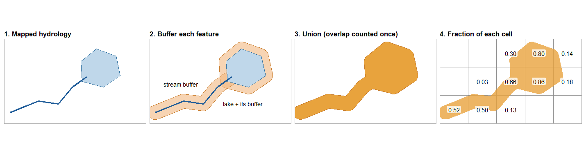
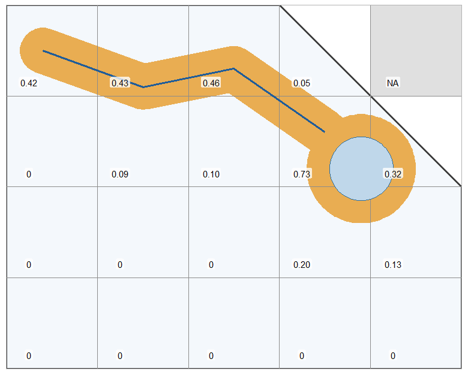
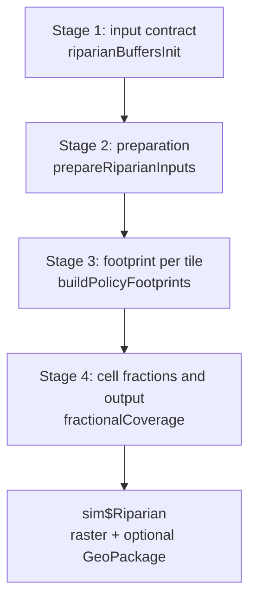
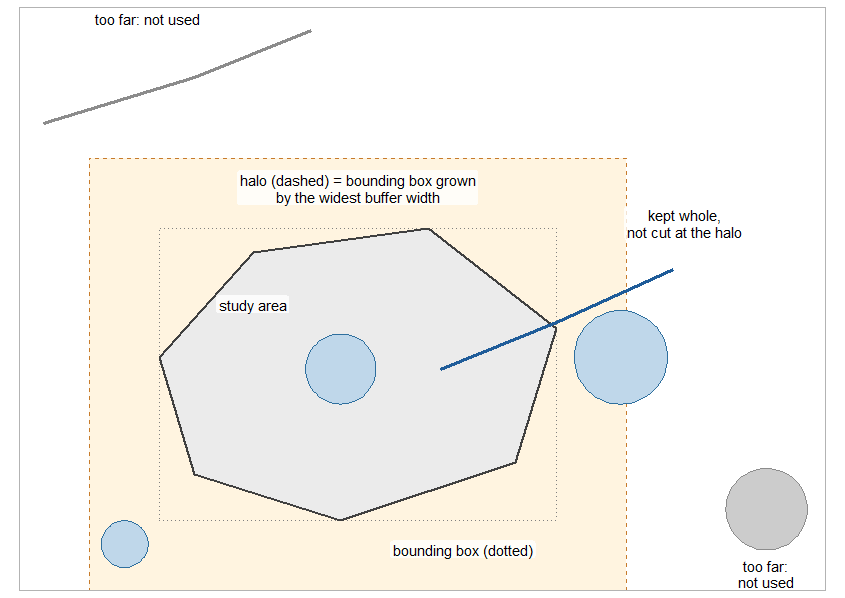
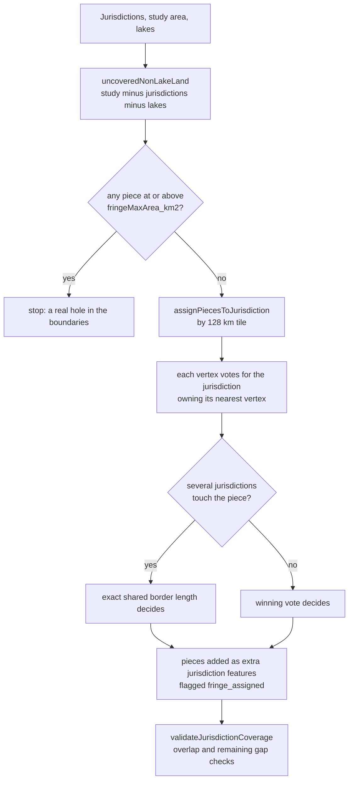
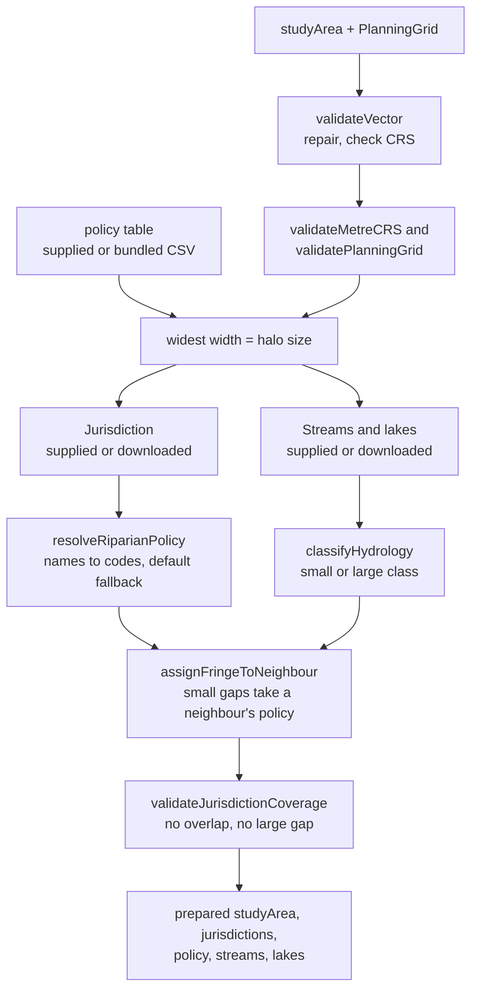
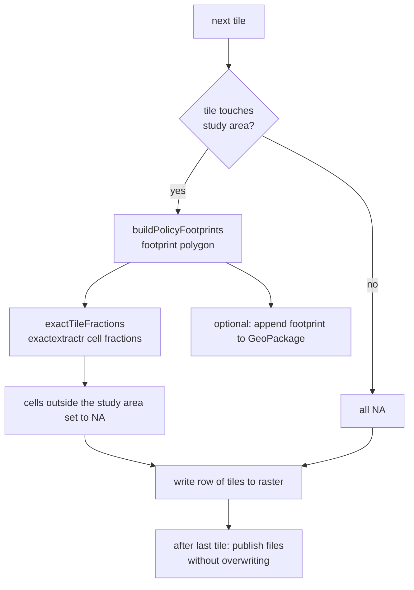
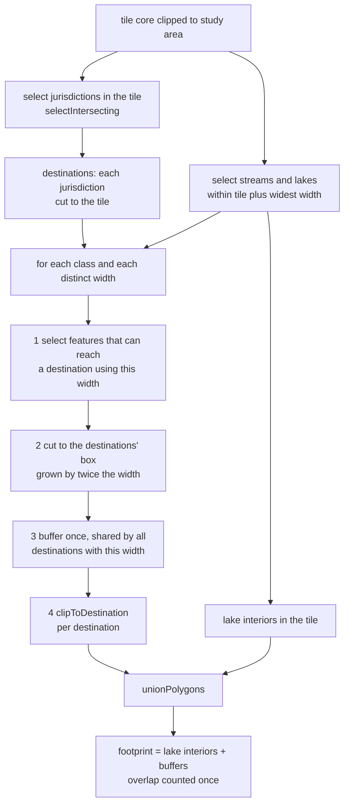

# RiparianBuffers

`RiparianBuffers` is a SpaDES module that answers one question for every
cell of a map grid: **what fraction of this cell is lake water or lies within a
protective buffer of a lake or stream?** The answer is a single-layer raster,
`sim$Riparian$riparianFraction`, with the same cells as the input
`PlanningGrid`. The module only reads its inputs and never changes them.

## Contents

1. [Simple terms](#simple-terms)
2. [What the numbers mean](#what-the-numbers-mean)
3. [Inputs](#inputs)
4. [How it works](#how-it-works)
5. [Outputs](#outputs)
6. [Using it in a simulation](#using-it-in-a-simulation)
7. [Validation and resource limits](#validation-and-resource-limits)

## Simple terms

| Word | Meaning here |
|---|---|
| Study area | The region you want results for (a polygon). |
| Planning grid | The grid of square cells the result is reported on. |
| Jurisdiction | A province or state. Each one has its own buffer widths. |
| Buffer | A band drawn around a stream or lake, a set distance wide. |
| Footprint | All the water and buffer area together, with overlaps counted once. |
| Fraction | The part of one grid cell covered by the footprint, from 0 to 1. |
| Halo | A margin around the study area, so features just outside it still count. |
| Tile | A block of grid cells (128 x 128 by default) processed one at a time. |
| Fringe | A tiny piece of land that no jurisdiction polygon covers, usually along a coast. |

## What the numbers mean

> The output measures combined lake-and-riparian-buffer coverage, not
> riparian land alone. Mapped lake water surfaces are included along with
> policy-width buffers on surrounding land. A planning cell entirely inside a
> mapped lake and the study area has `riparianFraction = 1`. Lake water
> overlapped by stream or lake buffers is counted once, not added repeatedly.
> The denominator is the full planning-cell area, including water. Cells
> entirely outside the study area are `NA`. These values are a hydrological
> influence/coverage signal, not a classification of harvestable land.

For example, 10 ha of buffered land plus 5 ha of mapped lake water in a 100 ha
cell gives 15 / 100 = 0.15, after merging any overlap. Streams are lines in the
source data, so they have no water surface of their own: only lake polygons and
the buffers contribute.

Cells on the edge of the study area are still divided by their **full** area, so
a cell that is only partly inside the study area gets a lower value. A cell that
is completely outside gets `NA`:

Fractions are exact area overlaps between polygons and cells, in the grid's
projected coordinate system (within a numerical tolerance of 1e-6). They are not
corrected for map-projection distortion, and they do not show that the source
hydrology or the policy is complete.

## Inputs

### Data inputs

Everything the module reads from the `simList`. Only `studyArea` and
`PlanningGrid` must be supplied.

| Input | Required | Type | What it is | If missing |
|---|---|---|---|---|
| `studyArea` | **Yes** | `SpatVector` or `sf` polygons, projected CRS in metres | The region to compute. | Stops with an error. |
| `PlanningGrid` | Practically yes | single-layer `SpatRaster`, same CRS as `studyArea`, extent covering it | The grid of cells the result is reported on. A supplied grid is used as is and never modified. | A 240 m grid over `studyArea` is built, only if no other module promises one. |
| `Jurisdiction` | No | `SpatVector` or `sf` polygons | Provinces or states. Must carry a name or code column (`jurisdiction_code`, `jurisdiction`, `NAME_En`, `name`, `postal`, ...). Must not overlap, and must cover all non-lake land of the study area, apart from small fringes (see below). | North American political divisions 2021 v3 is downloaded. |
| `riparianBufferPolicy` | No | `data.frame` | Buffer widths in metres per jurisdiction (columns below). Needs one `default` row. | The bundled `data/riparianBufferPolicy.csv` is used. |
| `Hydrology_streams` | No | `SpatVector` or `sf` lines | Stream lines with `ORD_STRA` (Strahler order) or a `hydro_class` column. | HydroRIVERS North America is downloaded. |
| `Hydrology_lakes` | No | `SpatVector` or `sf` polygons | Lake polygons with `Lake_area` (km2) or a `hydro_class` column. | Global HydroLAKES is downloaded. |

A valid, empty vector counts as "supplied": it means "none of this", and does
not trigger a download. If another module promises one of these inputs but has
not produced it by `init`, the module stops instead of downloading a competing
copy.

### Policy table (`riparianBufferPolicy`)

One row per jurisdiction, all widths in metres. Column names are fixed.

| Column | Meaning |
|---|---|
| `jurisdiction` | Code such as `ON`, or `default`. Province names are translated to codes. |
| `small_stream` | Width around streams of Strahler order below 4. |
| `large_stream` | Width around streams of Strahler order 4 or more. |
| `small_lake` | Width around lakes with `Lake_area` below 1 km2. |
| `large_lake` | Width around lakes with `Lake_area` of 1 km2 or more. |

The bundled table holds simplified analytical assumptions, **not legal
US/Canadian policy**:

| `jurisdiction` | `small_stream` | `large_stream` | `small_lake` | `large_lake` |
|---|---|---|---|---|
| `default` | 30 | 50 | 30 | 50 |
| `ON` | 30 | 50 | 30 | 50 |
| `QC` | 20 | 40 | 20 | 40 |
| `NB` | 30 | 50 | 30 | 50 |
| `NS` | 30 | 50 | 30 | 50 |
| `PE` | 30 | 50 | 30 | 50 |
| `NL` | 30 | 50 | 30 | 50 |

A jurisdiction with no row uses the `default` row. Each such case is reported in
`policyFallback`. A width of 0 means no buffer for that class.

### Parameters

| Parameter | Default | Meaning |
|---|---|---|
| `tileCells` | `128` | Cells per tile side. Larger tiles need more memory. |
| `fringeMaxArea_km2` | `50` | Uncovered land pieces smaller than this take a neighbouring jurisdiction's policy; a larger one stops the run. `0` turns the step off and keeps a strict check. |
| `exportVectorBuffer` | `TRUE` | Also write the footprint as a GeoPackage (`riparian_buffers.gpkg`). `FALSE` skips only that file; the raster is unchanged. |

### Folders and packages

| Item | Where |
|---|---|
| Downloaded and cached sources | `inputPath/RiparianBuffers/` |
| Result files | `outputPath/RiparianBuffers/` |
| Temporary staging | `scratchPath/RiparianBuffers/` (inside the output folder if no scratch path is set) |
| Packages | `SpaDES.core`, `terra`, `sf`, `exactextractr` |

Downloads are large, need internet access and disk space, and are cached for
reuse. A failed download or validation stops with the source's name, its URL and
the local folder.

### How streams and lakes are classified

| Feature | Rule | Class |
|---|---|---|
| Stream | `ORD_STRA` below 4 | `small_stream` |
| Stream | `ORD_STRA` 4 or more | `large_stream` |
| Lake | whole-lake `Lake_area` below 1 km2 | `small_lake` |
| Lake | whole-lake `Lake_area` 1 km2 or more | `large_lake` |

Attributes are checked, not invented: a missing, negative or conflicting value
stops the run.

## How it works

The module runs once, in the SpaDES `init` event. The work is done by the
functions in `R/`. This section explains the idea first, with drawings, then
shows how the functions are organised.

### The idea in four steps

| Stage | Main function | In plain words |
|---|---|---|
| 1. Input contract | `riparianBuffersInit` | Check that the study area, grid and parameters make sense. |
| 2. Preparation | `prepareRiparianInputs` | Load, repair and classify the data, and make sure every piece of land has a jurisdiction. |
| 3. Footprint | `buildPolicyFootprints` | For one tile, draw the buffers and merge them with the lakes. |
| 4. Fractions and output | `fractionalCoverage` | Measure how much of each cell the footprint covers, and write the files. |

### Step A: take only the data that can matter (the halo)

Reading a continent's worth of streams and lakes would be slow and wasteful.
The module draws a box around the study area, makes it bigger by the widest
buffer width, and keeps only features that touch that larger box (the halo).
Features are kept **whole**: a stream that crosses the halo edge is not cut
there, so no artificial endpoints are created.

Functions: `readRiparianHalo`, `selectRiparianHalo`.

### Step B: the buffer width depends on where the buffer lands

Each jurisdiction has its own widths. A stream that crosses a border does not
get one width for its whole length: the part that lands in jurisdiction A is
buffered with A's width, and the part that lands in B with B's width. The module
calls the jurisdiction that receives the buffer the **destination**.

Functions: `resolveRiparianPolicy`, `classifyHydrology`.

### Step C: small gaps between jurisdictions (fringes)

Jurisdiction outlines rarely match coastlines exactly, so thin slivers of land
are left with no jurisdiction. Without a rule the run would stop on the first
one. Instead, every uncovered piece smaller than `fringeMaxArea_km2` takes the
policy of its neighbour, chosen like this:

1. If it touches one jurisdiction, that one is used.
2. If it touches several, the one sharing the **longest border** wins.
3. If it touches none, the nearest one is used.

A piece at or above the limit is treated as a real hole in the boundaries and
stops the run, so a missing province is never hidden.

(Areas and border lengths in the drawing are in arbitrary units, with a limit of
200.)

Why the search is tiled: comparing every piece with the whole jurisdiction layer
(millions of vertices) ran out of memory on a large study area, so each group of
pieces is compared with a small crop of the layer. The count, total area and
largest piece are reported in a message and in `Riparian$fringeAssigned`.

Functions: `assignFringeToNeighbour`, `assignPiecesToJurisdiction`,
`uncoveredNonLakeLand`, `nonLakeLandArea`, `validateJurisdictionCoverage`.

### Preparation, end to end

Missing sources are obtained by `obtainRiparianSource`. `riparianSource` names
the three datasets, and `validateShapefile` and `zipShapefileProblem` check
cached and downloaded files before they are trusted.

### Step D: work one tile at a time

The grid can have millions of cells, so it is cut into tiles of `tileCells` x
`tileCells` cells and processed one after another, keeping only one row of tiles
in memory. Tiles outside the study area are skipped. A tile still uses features
that start just outside it, because a nearby stream's buffer reaches into the
tile.

Functions: `fractionalCoverage`, `exactTileFractions`.

### Step E: inside one tile

Buffering is the slowest part, because a buffer must be computed around every
vertex of a lake outline, and the largest lakes have hundreds of thousands of
vertices. So, for each class (small/large stream, small/large lake) and each
distinct width, the module does four things:

1. **Select.** Keep only features whose buffer could reach a destination that
   uses this width. Features that cannot reach it are never buffered (grey).
2. **Cut.** Cut those features to a box around the destinations, made bigger by
   **two widths** (red dashed line), then buffer the cut copy. This is safe: the
   buffer at a point depends only on source within one width of that point, and
   the cut edge is two widths away from every destination, so nothing inside a
   destination can notice the cut. For a huge lake this removes most of its
   vertices before the costly step.
3. **Buffer once.** Destinations that use the same width share one buffer. This
   matters because the fringe step can split one province into several
   destinations.
4. **Clip.** Give each destination the part of the buffer that lies inside it.
   Buffers wholly inside are kept as they are, and only the ones that cross the
   border go through the exact (slow) clip.

Lake surfaces are then added whatever the policy is, so a cell lying wholly
inside a big lake is fully covered. The final merge removes overlaps so that no
area is counted twice.

Functions: `buildPolicyFootprints`, `clipToDestination`, `selectIntersecting`,
`intersectPolygons`, `unionPolygons`, `polygonOnly`.

### Function map

| File | Functions | Role |
|---|---|---|
| `RiparianBuffers.R` | module definition | Parameters, inputs, outputs. |
| `riparianBuffersInit.R` | `riparianBuffersInit` | Stage 1; calls stages 2 and 4; stores `Riparian`. |
| `prepareRiparianInputs.R` | `prepareRiparianInputs`, `obtainRiparianSource`, `riparianSource`, `validateShapefile`, `zipShapefileProblem`, `readRiparianHalo`, `selectRiparianHalo` | Stage 2: obtain, read and select inputs. |
| `validateRiparianInputs.R` | `validateVector`, `validateMetreCRS`, `validatePlanningGrid`, `classifyHydrology` | Stage 2: validation and classes. |
| `validateRiparianInputs.R` | `uncoveredNonLakeLand`, `assignFringeToNeighbour`, `assignPiecesToJurisdiction`, `nonLakeLandArea`, `validateJurisdictionCoverage` | Fringes and the coverage check. |
| `resolveRiparianPolicy.R` | `resolveRiparianPolicy` | Maps jurisdictions to policy rows, with default fallback. |
| `buildPolicyFootprints.R` | `buildPolicyFootprints`, `clipToDestination`, `selectIntersecting`, `intersectPolygons`, `unionPolygons`, `polygonOnly` | Stage 3: the tile footprint. |
| `fractionalCoverage.R` | `fractionalCoverage`, `exactTileFractions` | Stage 4: tile loop, cell fractions, publication. |

The pictures are drawn by `scripts/make_readme_figures.R` from invented shapes
(nothing there reads real data) and saved in `docs/`.

### Precision notes

- Buffer edges are polygons with 30 segments per quarter circle, not ideal
  arcs. Exact coverage applies to those polygons.
- The tolerance for comparing results is an absolute difference of **1e-6** in
  the fraction (about 1 m2 in a 1000 m cell). It is recorded as
  `coverageTolerance`.
- Areas and widths are planar, in the grid's projected CRS.

## Outputs

`sim$Riparian` is a list:

| Element | Content |
|---|---|
| `riparianFraction` | The raster described above. |
| `rasterFile` | Path to `riparian_fraction.tif`. |
| `vectorBufferFile` | Path to `riparian_buffers.gpkg`, or `NULL` when export is off. |
| `policy` | The widths actually used, including filled-in defaults. |
| `policyFallback` | Jurisdictions that had no policy row and used `default`. |
| `fringeAssigned` | Pieces, area and largest piece assigned to each jurisdiction (or `NULL`). |
| `fringeMaxArea_km2`, `tileCells`, `exportVectorBuffer` | Parameters used. |
| `method`, `coverageConvention`, `coverageTolerance`, `projectionConvention`, `borderRule`, `streamConvention`, `lakeInteriorsExcluded` | Plain-text description of what was computed (`lakeInteriorsExcluded` is `FALSE`). |
| `sourceCRS`, `geometryRepairs`, `sources`, `haloWidth_m`, `haloExtent`, `policyAssumption` | Provenance: input coordinate systems, repairs, where data came from, and the halo. |

The GeoPackage is the final footprint (water plus buffers), in the output CRS. It
is not raw hydrology and not a habitat boundary. Its `tile_id` field names the
tile each piece came from. Neighbouring pieces may visibly meet at tile edges;
those are processing seams, not ecological boundaries, and no area is
duplicated. It is a single file with one layer, `riparian_buffers`, and has no
practical size limit, so the full study area can be exported (a Shapefile would
stop at 2 GiB).

Existing output names are protected: the module will not overwrite them. Files
are built in a staging folder and published only when complete.

## Using it in a simulation

Put the module in the module path and supply `studyArea` and, ideally,
`PlanningGrid`. The module publishes only `Riparian`. Any hydrology or
jurisdiction data it downloads stay inside the module, and the objects you
supplied are never altered.

See `scripts/demo_RiparianBuffers.R` for an offline synthetic run and
`EasternCanadaForAngela/run_riparianBuffers.R` for the opt-in Angela
setup.

## Validation and resource limits

Run the offline suite by sourcing `tests/unitTests.R` and calling
`unitTests(moduleDir, scratchDir)` with an explicit scratch folder. Tests cover
synthetic analytical fractions, mocked downloads, lake interiors, cross-border
policies, tile equivalence and file exports.

A 200 km Ottawa/Ontario-Quebec test at 1000 m resolution completed with vector
export in 106.71 seconds using exactextractr, versus 846.89 seconds with the
earlier sf cell-intersection engine. Shared input preparation took a further
75.89 seconds. The maximum fraction difference across that test was 1.09e-7,
with identical outside-study masks and no cells above 1e-6. These are single-run
timings, not a reliable full-area estimate.

A full run over the Eastern Canada (Angela) study area (6 features, about
3.7 million km2, 8.4 million cells at 1000 m, 544 tiles, no vector export)
completed in 110.5 minutes after the buffer optimisations described above,
against about 157 minutes before them: about 51 minutes of preparation
(including about 14 for fringe assignment and about 28 for the coverage check)
and 59 minutes in the tile loop. The two rasters have the same grid and the same
`NA` cells and mean (0.1653576). 454 of 3,719,184 valid cells differ by more than
1e-9, and two differ by slightly more than the 1e-6 tolerance (1.9e-6 and
1.6e-6); those two cells have not been investigated. The output was not compared
against an independent reference. Timings depend on the machine; the first
attempts to repeat this run ended in R session crashes while another process
held most of the machine's memory, and the cause was not isolated.

Start with a representative subset when trying new data.

`tileCells` defaults to 128 cells per tile side. Larger tiles can need more
memory and more complex geometry operations. No parallel processing is enabled.
Per-tile cost is dominated by buffering and clipping near very large lakes and by
destinations with very detailed boundaries.
